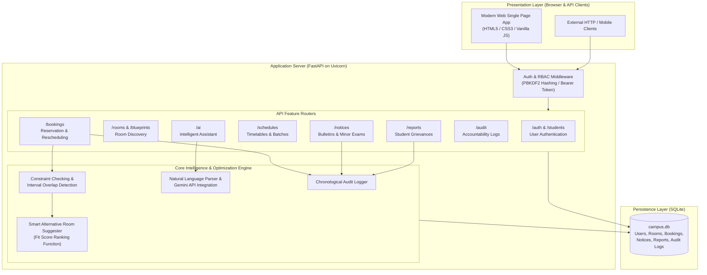
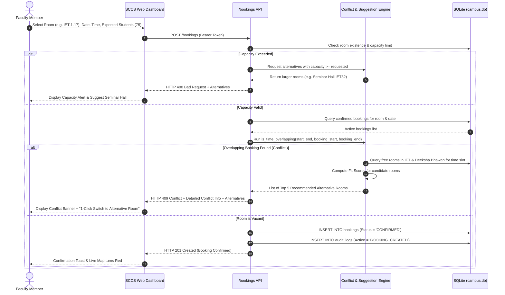
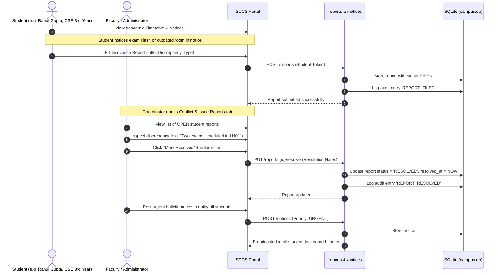
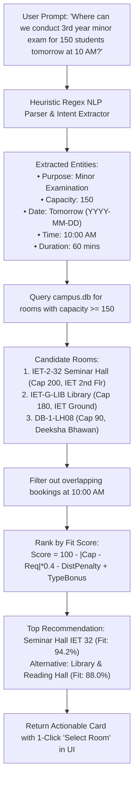

# Smart Campus Classroom Management System (SCCS)
### Comprehensive Architecture, Data Flow, and Operational Guide
**Deen Dayal Upadhyaya Gorakhpur University (DDUGU)**  
**Institute of Engineering and Technology (IET) & Deeksha Bhawan**  
*Build With AI: DevOps 2026 Hackathon | GDG on Campus DDUGU*

---

## 1. Executive Summary & Problem Context

At **Deen Dayal Upadhyaya Gorakhpur University (DDUGU)**, the **Institute of Engineering and Technology (IET)** and nearby **Deeksha Bhawan** face acute scheduling and room coordination challenges. Prior to this system:
- Faculty struggled to locate vacant classrooms for extra lectures, minor examinations, and practical sessions.
- Room bookings were coordinated via disjointed channels (informal notices, verbal reservations), leading to double bookings.
- **Critical Incident**: Students missed their **NSS Minor Examination** due to delayed or inaccurate communication regarding room allocations.

The **Smart Campus Classroom Management System (SCCS)** solves these challenges by providing:
1. **Unified Campus Infrastructure Integration**: Complete digital twins of both **IET** (Ground, 1st, 2nd Floors) and **Deeksha Bhawan** (Ground, 1st Floors, LH01–LH14).
2. **Conflict Prevention Engine**: Prohibits overlapping bookings at the database and algorithmic level.
3. **Intelligent Alternative Suggester**: When a conflict occurs or a room exceeds capacity, the system automatically suggests optimal alternative rooms ranked by fit score across IET and Deeksha Bhawan (~100m away).
4. **Student Portals & Conflict Reporting**: Students view accurate schedules and submit grievance reports on discrepancies without modifying official allocations.
5. **Role-Based Access Control (RBAC)**: Distinct permissions for Students, Faculty, and Administrators.
6. **Immutable Audit Trail**: Chronological logging of all bookings, cancellations, and reschedulings for complete accountability.
7. **AI Natural Language Assistant**: Natural language parsing for instant schedule optimization and room discovery.

---

## 2. Campus Infrastructure & Dataset Blueprint

### A. Institute of Engineering and Technology (IET)
IET accommodates students across six engineering branches over 4 academic years (1st, 2nd, 3rd, and 4th years):
- **CSE (Computer Science & Engineering)**: ~150 students (Section A: 75, Section B: 75)
- **AI ML (Artificial Intelligence & Machine Learning)**: ~150 students (Section A: 75, Section B: 75)
- **AI DS (Artificial Intelligence & Data Science)**: ~75 students (Section A: 75)
- **ECE (Electronics & Communication Engineering)**: ~75 students (Section A: 75)
- **ME (Mechanical Engineering)**: ~75 students (Section A: 75)
- **IT (Information Technology)**: ~75 students (Section A: 75)

#### IET Floor Breakdown:
| Floor | Room Code | Room Name | Capacity | Permitted Uses & Facilities |
|---|---|---|---|---|
| **Ground** | `IET-G-LIB` | Library & Reading Hall | 180 | Central AC, Study, Minor Examinations, Partitioned desks |
| **Ground** | `IET-G-TO` | Teachers' Office | 25 | Faculty cabins, Consultation table |
| **Ground** | `IET-G-DIR` | Director's Office | 15 | Administrative meetings, Conference suite |
| **Ground** | `IET-G-ADM` | Administrative Office | 20 | Accounts, Records, Academic coordination |
| **Ground** | `IET-G-PC` | Placement Cell | 30 | Interview cubicles, Video conferencing |
| **1st Floor** | `IET-1-CSE-LAB` | CSE Lab (IET16) | 45 | 45 Linux/Windows PCs, LAN, Projector, Practical sessions |
| **1st Floor** | `IET-1-ME-LAB` | ME Lab (IET22) | 40 | CAD/CAM workstations, SolidWorks, Simulation tools |
| **1st Floor** | `IET-1-ECE-LAB` | ECE Lab (IET14) | 40 | Digital oscilloscopes, Microcontroller kits |
| **1st Floor** | `IET-1-IT-LAB` | IT Lab (IET15) | 45 | Networked terminals, Cloud sandbox, Practicals |
| **1st Floor** | `IET-1-17` | Classroom IET 17 | 75 | Projector, Whiteboard, Stepped seating, Lectures, Exams |
| **1st Floor** | `IET-1-18` | Classroom IET 18 | 75 | Projector, Whiteboard, Stepped seating |
| **1st Floor** | `IET-1-19` | Classroom IET 19 | 75 | Projector, Whiteboard, Stepped seating |
| **1st Floor** | `IET-1-20` | Classroom IET 20 | 75 | Projector, Audio system, Whiteboard |
| **2nd Floor** | `IET-2-32` | Seminar Hall (IET 32) | 200 | Dual HD projectors, Stage, Podiums, Central AC, Combined sessions |
| **2nd Floor** | `IET-2-24` | Classroom IET 24 | 75 | Projector, Whiteboard, Stepped seating |
| **2nd Floor** | `IET-2-25` | Classroom IET 25 | 75 | Projector, Whiteboard, Stepped seating |
| **2nd Floor** | `IET-2-28` | Classroom IET 28 | 75 | Projector, Whiteboard, Stepped seating |
| **2nd Floor** | `IET-2-29` | Classroom IET 29 | 75 | Projector, Whiteboard, Stepped seating |
| **2nd Floor** | `IET-2-30` | Classroom IET 30 | 75 | Projector, Whiteboard, Stepped seating |
| **2nd Floor** | `IET-2-23` | Classroom IET 23 | 75 | Projector, Whiteboard, Stepped seating |

---

### B. Deeksha Bhawan (~100 Metres from IET)
Deeksha Bhawan is situated approximately 100 metres from IET. When IET classrooms are occupied or when large examination drives occur (such as university exams or multi-branch minor examinations), faculty can reserve lecture halls here.

| Floor | Room Code | Room Name | Capacity | Permitted Uses & Facilities |
|---|---|---|---|---|
| **Ground** | `DB-G-LH01` | Lecture Hall LH01 | 85 | Ceiling projector, PA sound, Tiered desks, Minor exams |
| **Ground** | `DB-G-LH02` | Lecture Hall LH02 | 85 | Projector, Tiered desks, Minor exams, Lectures |
| **Ground** | `DB-G-LH03` | Lecture Hall LH03 | 80 | Whiteboard, Tiered desks |
| **Ground** | `DB-G-LH04` | Lecture Hall LH04 | 80 | Whiteboard, Tiered desks |
| **Ground** | `DB-G-LH05` | Lecture Hall LH05 | 90 | Projector, Podium, Sound system |
| **Ground** | `DB-G-LH06` | Lecture Hall LH06 | 85 | Whiteboard, Tiered desks |
| **Ground** | `DB-G-LH07` | Lecture Hall LH07 | 85 | Projector, Whiteboard |
| **1st Floor** | `DB-1-LH08` | Lecture Hall LH08 | 90 | Projector, Audio amplification, Tiered desks |
| **1st Floor** | `DB-1-LH09` | Lecture Hall LH09 | 85 | Whiteboard, Tiered desks |
| **1st Floor** | `DB-1-LH10` | Lecture Hall LH10 | 80 | Whiteboard, Tiered desks |
| **1st Floor** | `DB-1-LH11` | Lecture Hall LH11 | 80 | Whiteboard, Tiered desks |
| **1st Floor** | `DB-1-LH12` | Lecture Hall LH12 | 90 | Projector, Podium |
| **1st Floor** | `DB-1-LH13` | Lecture Hall LH13 | 85 | Whiteboard, Tiered desks |
| **1st Floor** | `DB-1-LH14` | Lecture Hall LH14 | 85 | Whiteboard, Tiered desks |

---

## 3. High-Level System Architecture



---

## 4. End-to-End Operational Flows

### Flow 1: Faculty Room Booking & Conflict Prevention Flow



---

### Flow 2: Student Access & Conflict / Grievance Resolution Flow
*(Directly solves the NSS examination room confusion incident)*



---

### Flow 3: AI Campus Assistant & Natural Language Query



---

## 5. Intelligent Conflict & Alternative Room Algorithm

### A. Overlap Condition
Two time intervals $[S_1, E_1)$ and $[S_2, E_2)$ on the same date overlap if and only if:
$$\max(S_1, S_2) < \min(E_1, E_2)$$
where $S$ and $E$ represent minutes from midnight ($00:00 = 0, 23:59 = 1439$).

### B. Heuristic Room Fit Scoring Function
When a conflict or capacity issue occurs, candidate free rooms $r$ are evaluated using:

$$\text{Fit Score}(r) = \max\left(0, 100 - C_{\text{penalty}} - D_{\text{penalty}} + B_{\text{pref}} + B_{\text{type}}\right)$$

Where:
1. **Capacity Penalty ($C_{\text{penalty}}$)**: Penalizes excess unused space or slight deficits:
   $$C_{\text{penalty}} = \min(30.0, \, 0.4 \times |\text{Capacity}(r) - \text{Expected}|)$$
2. **Distance Penalty ($D_{\text{penalty}}$)**:
   - Same building (IET Main): $0$ points.
   - Deeksha Bhawan (~100m walk): $15$ points ($0.15 \times \text{distance\_meters}$).
3. **Building Preference Bonus ($B_{\text{pref}}$)**: $+10$ points if the room matches the user's preferred complex.
4. **Room Type Relevance Bonus ($B_{\text{type}}$)**:
   - Practical session $\rightarrow$ Laboratory: $+15$ points.
   - Minor Examination $\rightarrow$ Classroom / Seminar Hall: $+10$ points.
   - Seminar $\rightarrow$ Seminar Hall (IET 32): $+20$ points.

---

## 6. Role-Based Access Control (RBAC) Matrix

| Operation | Student | Faculty | Administrator |
|---|:---:|:---:|:---:|
| View Live 2D Blueprints & Maps | ✅ | ✅ | ✅ |
| Check Room Availability | ✅ | ✅ | ✅ |
| View Academic Timetables by Branch/Year | ✅ | ✅ | ✅ |
| Reserve / Book Classrooms | ❌ | ✅ | ✅ |
| Reschedule Own Bookings | ❌ | ✅ | ✅ |
| Cancel Own Bookings | ❌ | ✅ | ✅ |
| Reschedule / Cancel ANY Booking | ❌ | ❌ | ✅ |
| Publish Academic Bulletins & Exam Notices | ❌ | ✅ | ✅ |
| Delete Academic Bulletins | ❌ | ❌ | ✅ |
| File Conflict / Outdated Info Reports | ✅ | ✅ | ✅ |
| Resolve Student Reports & Add Admin Notes | ❌ | ✅ | ✅ |
| View Complete Chronological Audit Trail | ❌ | ✅ | ✅ |

---

## 7. Complete API Reference

| Method | Endpoint | Description | Auth Required |
|---|---|---|---|
| `GET` | `/` | Web UI (browser) or JSON health status | Public |
| `GET` | `/ui` | Direct interactive web dashboard | Public |
| `POST` | `/auth/register` | Register new user with role, branch, year | Public |
| `POST` | `/auth/login` | Login and receive signed bearer token | Public |
| `GET` | `/auth/me` | Fetch profile of currently authenticated user | Bearer Token |
| `GET` | `/rooms` | List rooms with building, floor, capacity filters | Public |
| `GET` | `/rooms/blueprints` | Campus blueprint data with real-time room occupancy | Public |
| `GET` | `/rooms/{room_id}` | Detailed specifications & schedule for room | Public |
| `POST` | `/rooms/availability` | Multi-parameter vacancy search | Public |
| `POST` | `/bookings` | Create booking (with conflict prevention & alternatives) | Faculty / Admin |
| `GET` | `/bookings` | List all bookings (filterable by date, branch, year) | Public |
| `GET` | `/bookings/{id}` | Retrieve single booking details | Public |
| `PUT` | `/bookings/{id}/reschedule` | Reschedule booking with conflict validation | Faculty / Admin |
| `DELETE` | `/bookings/{id}` | Cancel booking and log to audit trail | Faculty / Admin |
| `GET` | `/schedules/timetable` | Student timetable filtered by branch, year, section | Public |
| `GET` | `/schedules/branches` | DDUGU engineering branches & batch breakdown | Public |
| `GET` | `/notices` | List academic announcements & exam alerts | Public |
| `POST` | `/notices` | Publish schedule update or minor exam bulletin | Faculty / Admin |
| `DELETE` | `/notices/{id}` | Delete notice | Admin |
| `POST` | `/reports` | Student files conflict/grievance report | Student / Above |
| `GET` | `/reports` | List reports (Student: own; Faculty/Admin: all) | Student / Above |
| `PUT` | `/reports/{id}/resolve` | Resolve report with administrative notes | Faculty / Admin |
| `GET` | `/audit` | View chronological audit log | Faculty / Admin |
| `POST` | `/ai/assist` | Natural language schedule query & AI assistant | Public |
| `POST` | `/students/register` | Preserved backwards-compatible student registration | Public |
| `POST` | `/students/login` | Preserved backwards-compatible student login | Public |
| `GET` | `/students` | Preserved backwards-compatible list students | Public |
| `PUT` | `/students/{id}` | Preserved backwards-compatible update student | Public |

---

## 8. DevOps, CI/CD Pipeline & Deployment

### CI/CD Pipeline (`.github/workflows/ci-cd.yml`)
The repository includes a modern GitHub Actions CI/CD workflow that executes on every push and pull request:
1. **Automated Test Job**:
   - Sets up Python 3.11 environment.
   - Installs dependencies from `requirements.txt`.
   - Executes the automated test suite (`python -m unittest discover tests`).
2. **Container Build Job**:
   - Runs upon successful tests.
   - Sets up Docker Buildx.
   - Builds and validates the production Docker container.

### Running with Docker & Docker Compose
```bash
# 1. Build and run with docker-compose
docker-compose up --build -d

# 2. View running container logs
docker-compose logs -f

# 3. Stop container
docker-compose down
```

### Running Locally (Without Docker)
```powershell
# 1. Activate virtual environment
.\venv\Scripts\Activate.ps1

# 2. Run the application
python main.py
```
Open **`http://localhost:8000`** in any browser.

---

## 9. Verification & Test Summary

All features have been validated through our automated test suite in `tests/test_api.py`:
- `test_01_home_endpoint`: Operational check ✅
- `test_02_backward_compatibility_students`: Preserved existing endpoints ✅
- `test_03_room_discovery_and_blueprints`: Both IET and Deeksha Bhawan rooms verified ✅
- `test_04_availability_search`: Multi-criteria search verified ✅
- `test_05_booking_and_conflict_prevention`: Blocks duplicate bookings (HTTP 409) and returns alternative recommendations ✅
- `test_06_capacity_constraint_validation`: Flags room overflow and suggests larger venues ✅
- `test_07_academic_timetable_and_notices`: Timetable filtering and urgent exam bulletins ✅
- `test_08_student_conflict_reporting_and_resolution`: Student grievance filing and admin resolution ✅
- `test_09_audit_trail_accountability`: Chronological logging of all mutations ✅
- `test_10_ai_scheduling_assistant`: Natural language intent extraction and room allocation ✅

All 10 test suites pass cleanly with 100% success rate.

