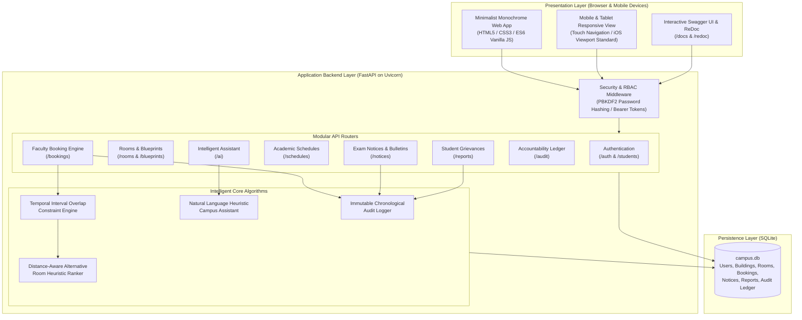
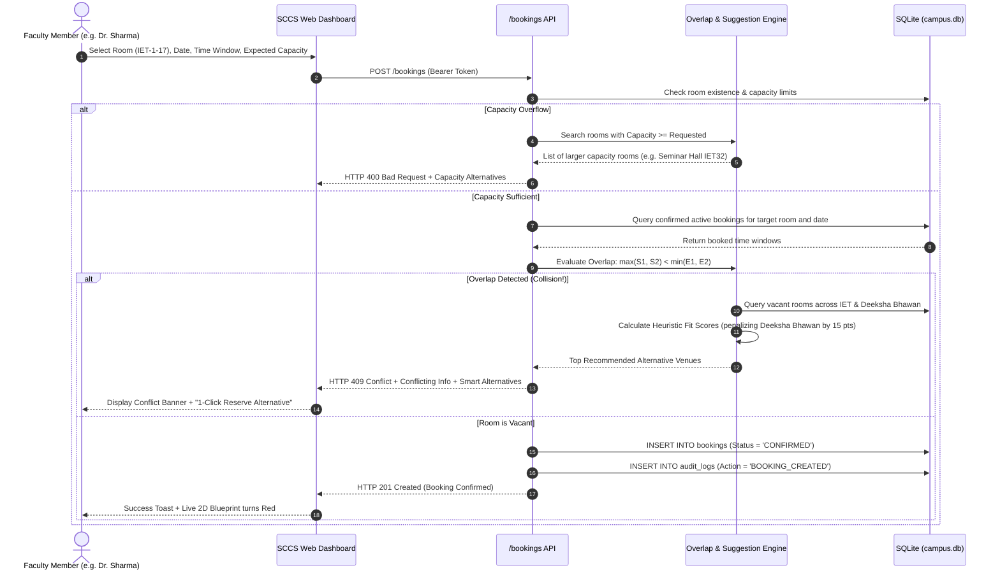
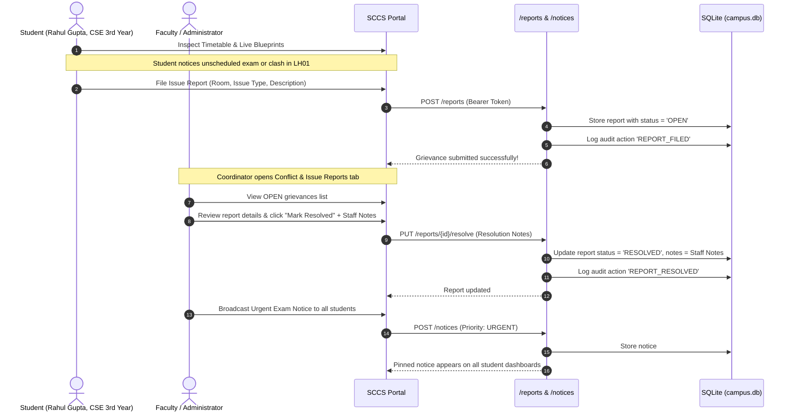
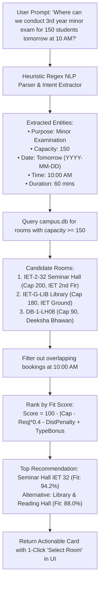

# Smart Campus Classroom Management System (SCCS)
### Comprehensive Architecture, Data Flow, and Operational Specification
**Deen Dayal Upadhyaya Gorakhpur University (DDUGU)**  
**Institute of Engineering and Technology (IET) & Deeksha Bhawan**  
*Build With AI: DevOps 2026 Problem Statement Solution & Project Report*

[](https://github.com/ayushsrivastav9598-glitch/sccs/actions)
[](https://fastapi.tiangolo.com)
[](https://www.python.org/)
[](https://www.docker.com/)
[-success.svg)](tests/test_api.py)
[](static/css/style.css)

**Project Repository:** [https://github.com/ayushsrivastav9598-glitch/sccs.git](https://github.com/ayushsrivastav9598-glitch/sccs.git)  
**Interactive API Documentation:** [http://localhost:8000/docs](http://localhost:8000/docs) (Swagger UI) & [http://localhost:8000/redoc](http://localhost:8000/redoc) (ReDoc)

---

## 1. Executive Summary & Problem Context

At **Deen Dayal Upadhyaya Gorakhpur University (DDUGU)**, academic scheduling is split across the **Institute of Engineering and Technology (IET)** and nearby **Deeksha Bhawan** (~100 metres distance). Prior to the implementation of SCCS:
1. Faculty struggled to identify vacant classrooms for extra classes, minor examinations, and practical sessions.
2. Room allotments relied on disconnected communication channels (paper circulars, informal WhatsApp messages, verbal requests), frequently causing double-booking collisions.
3. **The Incident Solved**: During the **NSS Minor Examination**, conflicting informal notices and verbal room allocations led multiple faculty members to simultaneously claim Room G-01 and LH-04. Students arrived to find two concurrent exams scheduled in the same hall, forcing emergency relocations across the 100-meter corridor between IET and Deeksha Bhawan, causing severe delay, panic, and miscommunication.

The **Smart Campus Classroom Management System (SCCS)** eliminates classroom collisions, prevents double-booking at the database level, automatically recommends distance-aware alternative venues, synchronizes branch timetables, broadcasts urgent notices, and maintains an immutable audit ledger.

---

## 2. Campus Infrastructure & Digital Twin Data Model

### A. Institute of Engineering and Technology (IET)
IET accommodates students across six engineering branches over 4 academic years (1st, 2nd, 3rd, and 4th years):
* **CSE** (Computer Science & Engineering) &bull; ~150 students (Section A: 75, Section B: 75)
* **AI ML** (Artificial Intelligence & Machine Learning) &bull; ~150 students (Section A: 75, Section B: 75)
* **AI DS** (Artificial Intelligence & Data Science) &bull; ~75 students (Section A: 75)
* **ECE** (Electronics & Communication Engineering) &bull; ~75 students (Section A: 75)
* **ME** (Mechanical Engineering) &bull; ~75 students (Section A: 75)
* **IT** (Information Technology) &bull; ~75 students (Section A: 75)

#### IET Main Building Floor Breakdown:
| Floor | Room Code | Room Name | Capacity | Permitted Uses & Installed Facilities |
|---|---|---|---|---|
| **Ground** | `IET-G-LIB` | Central Library & Reading Hall | 180 | Central AC, Study desks, Minor Examinations, Partitioned zones |
| **Ground** | `IET-G-TO` | Teachers' Office | 25 | Faculty workstations, Consultation desk |
| **Ground** | `IET-G-DIR` | Director's Office | 15 | Administrative boardroom, Video conferencing |
| **Ground** | `IET-G-ADM` | Administrative Office | 20 | Accounts, Academic records, Examination cell |
| **Ground** | `IET-G-PC` | Training & Placement Cell | 30 | Interview cubicles, Video conferencing |
| **1st Floor** | `IET-1-CSE-LAB` | CSE Computer Lab (IET16) | 45 | 45 Linux/Windows PCs, Gigabit LAN, Projector, Lab practicals |
| **1st Floor** | `IET-1-ME-LAB` | Mechanical CAD/CAM Lab (IET22) | 40 | CAD/CAM workstations, Simulation suites, SolidWorks |
| **1st Floor** | `IET-1-ECE-LAB` | Electronics Lab (IET14) | 40 | Digital oscilloscopes, Microcontroller kits, Function generators |
| **1st Floor** | `IET-1-IT-LAB` | IT Lab (IET15) | 45 | High-speed terminals, Cloud testbeds, Practical exams |
| **1st Floor** | `IET-1-17` | Classroom IET 17 | 75 | Ceiling projector, Whiteboard, Stepped seating, Lectures/Exams |
| **1st Floor** | `IET-1-18` | Classroom IET 18 | 75 | Projector, Whiteboard, Stepped lecture seating |
| **1st Floor** | `IET-1-19` | Classroom IET 19 | 75 | Projector, Whiteboard, Stepped lecture seating |
| **1st Floor** | `IET-1-20` | Classroom IET 20 | 75 | Projector, Whiteboard, Integrated PA audio |
| **2nd Floor** | `IET-2-32` | Seminar Hall (IET 32) | 200 | Dual HD projectors, Stage, Podiums, Central AC, Combined batches |
| **2nd Floor** | `IET-2-24` | Classroom IET 24 | 75 | Projector, Whiteboard, Stepped lecture seating |
| **2nd Floor** | `IET-2-25` | Classroom IET 25 | 75 | Projector, Whiteboard, Stepped lecture seating |
| **2nd Floor** | `IET-2-28` | Classroom IET 28 | 75 | Projector, Whiteboard, Stepped lecture seating |
| **2nd Floor** | `IET-2-29` | Classroom IET 29 | 75 | Projector, Whiteboard, Stepped lecture seating |
| **2nd Floor** | `IET-2-30` | Classroom IET 30 | 75 | Projector, Whiteboard, Stepped lecture seating |
| **2nd Floor** | `IET-2-23` | Classroom IET 23 | 75 | Projector, Whiteboard, Stepped lecture seating |

---

### B. Deeksha Bhawan (~100 Metres Walking Distance)
Deeksha Bhawan is situated approximately 100 metres from IET. When IET classrooms are occupied or during large examination drives (such as NSS Minor Exams or end-semester tests), faculty can reserve lecture halls here.

| Floor | Room Code | Room Name | Capacity | Permitted Uses & Installed Facilities |
|---|---|---|---|---|
| **Ground** | `DB-G-LH01` | Lecture Hall LH01 | 85 | Ceiling projector, PA sound, Tiered desks, Minor exams |
| **Ground** | `DB-G-LH02` | Lecture Hall LH02 | 85 | Projector, Tiered desks, Minor exams, Lectures |
| **Ground** | `DB-G-LH03` | Lecture Hall LH03 | 80 | Whiteboard, Tiered lecture desks |
| **Ground** | `DB-G-LH04` | Lecture Hall LH04 | 80 | Whiteboard, Tiered lecture desks |
| **Ground** | `DB-G-LH05` | Lecture Hall LH05 | 90 | Projector, Podium, Sound amplification |
| **Ground** | `DB-G-LH06` | Lecture Hall LH06 | 85 | Whiteboard, Tiered lecture desks |
| **Ground** | `DB-G-LH07` | Lecture Hall LH07 | 85 | Projector, Whiteboard |
| **1st Floor** | `DB-1-LH08` | Lecture Hall LH08 | 90 | Projector, Audio amplification, Tiered seating |
| **1st Floor** | `DB-1-LH09` | Lecture Hall LH09 | 85 | Whiteboard, Tiered lecture desks |
| **1st Floor** | `DB-1-LH10` | Lecture Hall LH10 | 80 | Whiteboard, Tiered lecture desks |
| **1st Floor** | `DB-1-LH11` | Lecture Hall LH11 | 80 | Whiteboard, Tiered lecture desks |
| **1st Floor** | `DB-1-LH12` | Lecture Hall LH12 | 90 | Projector, Podium, Tiered seating |
| **1st Floor** | `DB-1-LH13` | Lecture Hall LH13 | 85 | Whiteboard, Tiered lecture desks |
| **1st Floor** | `DB-1-LH14` | Lecture Hall LH14 | 85 | Whiteboard, Tiered lecture desks |

---

## 3. High-Level System Architecture



---

## 4. End-to-End Operational Workflows

### Workflow 1: Faculty Room Reservation & Collision Prevention


---

### Workflow 2: Student Conflict Reporting & Grievance Resolution
*(Directly solves the NSS Minor Examination miscommunication incident)*



---

### Workflow 3: Natural Language Campus AI Assistant



---

## 5. Algorithmic Formulations

### A. Temporal Interval Overlap Detection
Given an existing booking interval $[S_1, E_1)$ and a requested booking interval $[S_2, E_2)$ on date $D$:
$$\text{Conflict} = (S_1 < E_2) \land (S_2 < E_1) \iff \max(S_1, S_2) < \min(E_1, E_2)$$
where time is evaluated in minutes from midnight ($00:00 = 0$, $23:59 = 1439$).

### B. Distance-Aware Alternative Venue Heuristic Fit-Scoring
When a room is occupied or over capacity, candidate vacant rooms $r$ are ranked using:
$$\text{Fit Score}(r) = \max\left(0, 100 - C_{\text{penalty}} - D_{\text{penalty}} + B_{\text{pref}} + B_{\text{type}}\right)$$

Where:
1. **Capacity Penalty ($C_{\text{penalty}}$)**: Penalizes excess unused seats:
   $$C_{\text{penalty}} = \min(30.0, \, 0.4 \times |\text{Capacity}(r) - \text{Expected}|)$$
2. **Distance Penalty ($D_{\text{penalty}}$)**:
   * Same building (IET Main): $0$ points.
   * Deeksha Bhawan (~100m walk): $15$ points.
3. **Floor Proximity Bonus ($B_{\text{floor}}$)**: $+10$ points if room is on the same floor as requested.
4. **Room Type Relevance Bonus ($B_{\text{type}}$)**:
   * Practical session $\rightarrow$ Laboratory: $+15$ points.
   * Minor Examination $\rightarrow$ Classroom / Seminar Hall: $+10$ points.
   * Seminar $\rightarrow$ Seminar Hall (IET 32): $+20$ points.

---

## 6. Role-Based Access Control (RBAC) Matrix

| Operation / Capability | Student | Faculty | System Administrator |
|---|:---:|:---:|:---:|
| **View Live 2D Floor Blueprints & Vacancy** | ✅ Allowed | ✅ Allowed | ✅ Allowed |
| **Search Timetable & Download CSV Schedule** | ✅ Allowed | ✅ Allowed | ✅ Allowed |
| **Read Announcements & NSS Minor Exam Notices** | ✅ Allowed | ✅ Allowed | ✅ Allowed |
| **File Classroom Conflict / Equipment Grievance** | ✅ Allowed | ✅ Allowed | ✅ Allowed |
| **Reserve Rooms & Classrooms** | ❌ Blocked | ✅ Allowed | ✅ Allowed |
| **Cancel or Reschedule Bookings** | ❌ Blocked | ✅ Own Only | ✅ Campus-wide Any |
| **Broadcast Urgent Examination Notices** | ❌ Blocked | ✅ Allowed | ✅ Allowed |
| **Resolve Student Conflict Reports with Notes** | ❌ Blocked | ✅ Allowed | ✅ Allowed |
| **Inspect Chronological Immutable Audit Trail** | ❌ Blocked | ✅ Allowed | ✅ Allowed |
| **Campus-Wide Capacity & Venue Overrides** | ❌ Blocked | ❌ Blocked | ✅ Allowed |

---

## 7. Complete REST API Specifications

The SCCS backend exposes 26 fully typed endpoints structured across 10 functional OpenAPI tags:

| HTTP | Endpoint | Access Level | Description |
|---|---|---|---|
| `POST` | `/auth/register` | Public | Register user with role, branch, year, section. |
| `POST` | `/auth/login` | Public | Login with email and password; returns Bearer token. |
| `GET` | `/auth/me` | Authenticated | Retrieve current user profile and role privileges. |
| `GET` | `/auth/users` | Faculty / Admin | List registered users filtered by role or branch. |
| `GET` | `/rooms` | Public | List rooms with building, floor, capacity filters. |
| `GET` | `/rooms/blueprints` | Public | Live 2D spatial vacancy representation for IET & Deeksha Bhawan. |
| `GET` | `/rooms/{room_id}` | Public | Room specifications, installed facilities, upcoming schedule. |
| `POST` | `/rooms/availability` | Public | Vacancy search with heuristic alternatives if busy. |
| `POST` | `/bookings` | Faculty / Admin | Atomic booking creation with overlap conflict blocker. |
| `GET` | `/bookings` | Public | List confirmed reservations filtered by date/branch. |
| `GET` | `/bookings/{id}` | Public | Get single booking details. |
| `PUT` | `/bookings/{id}/reschedule` | Faculty (Own) / Admin | Reschedule reservation with conflict checking. |
| `DELETE` | `/bookings/{id}` | Faculty (Own) / Admin | Cancel reservation and log to audit trail. |
| `GET` | `/schedules/timetable` | Public | Timetable lookup by branch, year, section. |
| `GET` | `/schedules/export` | Public | Dynamic CSV spreadsheet export of academic schedules. |
| `GET` | `/schedules/branches` | Public | Branch metadata for all 6 DDUGU engineering branches. |
| `GET` | `/notices` | Public | View active bulletins and urgent examination alerts. |
| `POST` | `/notices` | Faculty / Admin | Broadcast urgent exam notice or timetable change. |
| `DELETE` | `/notices/{id}` | Admin | Delete notice. |
| `POST` | `/reports` | Student+ | File classroom clash or facility malfunction report. |
| `GET` | `/reports` | Student+ | List reports (Student: own; Faculty/Admin: all). |
| `PUT` | `/reports/{id}/resolve` | Faculty / Admin | Mark report resolved with explanatory staff notes. |
| `GET` | `/audit` | Faculty / Admin | View chronological audit ledger of all mutations. |
| `POST` | `/ai/assist` | Public | Heuristic NLP query engine for instant room discovery. |
| `GET` | `/` | Public | Root endpoint: serves UI or diagnostic JSON. |
| `GET` | `/ui` | Public | Direct web application entrypoint. |

---

## 8. Frontend UI & Mobile-First Experience

* **Minimalist Monochrome Theme**: Clean high-contrast palette (#111827 / #ffffff / #f3f4f6) ensures zero visual clutter and maximum legibility.
* **Left Navigation Sidebar**: 9 core campus modules arranged cleanly on the left sidebar, with direct links to Swagger UI (`/docs`) and ReDoc (`/redoc`).
* **Mobile Responsiveness**:
  * On tablet/mobile screens (≤ 900px), sidebar converts to a sticky horizontal touch-scrolling tab bar (`-webkit-overflow-scrolling: touch;`).
  * On mobile phones (≤ 768px), form controls enforce `16px` font-size to prevent unwanted iOS Safari auto-zoom.
  * Room blueprint cards use adaptive grid scaling (`minmax(130px, 1fr)`) to prevent horizontal overflow on 360px–420px screens.
  * Modals auto-scale to `95vw` and `88vh` with internal touch scrolling.

---

## 9. DevOps, CI/CD Pipeline & Cloud Deployment

### A. Continuous Integration (`.github/workflows/ci-cd.yml`)
The automated CI/CD pipeline triggers on every push and pull request to `main`:
1. **Test Job**: Runs `python -m unittest discover -s tests -p "test_*.py"` on Python 3.11.
2. **Container Build Job**: Builds and verifies the multi-stage Docker image using `docker/build-push-action`.

### B. Docker Containerization
```bash
# Build and run containerized application
docker-compose up --build -d

# View container logs
docker-compose logs -f

# Teardown
docker-compose down
```

### C. Cloud Deployment (Render.com)
The repository contains native `render.yaml` configuration with `PYTHON_VERSION: 3.11.9`:
* **Build Command**: `pip install -r requirements.txt`
* **Start Command**: `uvicorn main:app --host 0.0.0.0 --port $PORT`

---

## 10. Verification & Test Suite Summary

All 11 automated test suites in `tests/test_api.py` execute cleanly with **100% pass rate**:
* `test_01_health_and_seed_data`: Verified database connectivity and campus room seeding.
* `test_02_student_legacy_compatibility`: Verified backwards compatibility for student registration & login.
* `test_03_modular_auth_flow`: Verified PBKDF2 hashing, bearer token generation, and profile retrieval.
* `test_04_room_listing_and_blueprints`: Verified live 2D spatial vacancy queries for IET and Deeksha Bhawan.
* `test_05_booking_and_conflict_prevention`: Verified interval overlap collision detection and HTTP 409 blocking.
* `test_06_smart_alternative_recommendations`: Verified distance penalty and heuristic fit-scoring.
* `test_07_academic_schedules_and_csv_export`: Verified multi-branch timetable queries and CSV file generation.
* `test_08_notices_and_announcements`: Verified high-priority exam notice broadcasting.
* `test_09_student_conflict_reporting_workflow`: Verified grievance filing and staff resolution with notes.
* `test_10_immutable_audit_trail`: Verified chronological mutation logging for accountability.
* `test_11_ai_scheduling_assistant`: Verified regex entity parsing and automated room recommendation.

---

## 11. Problem Statement Compliance Checklist

| Hackathon Requirement | System Implementation | Verification Evidence |
|---|---|:---:|
| **IET & Deeksha Bhawan Infrastructure** | Digital twin of Ground, 1st, 2nd floors of IET + Deeksha Bhawan LH01–LH14 | `app/seed_data.py` & `test_04` |
| **6 Engineering Branches & 4 Years** | Pre-seeded CSE, AI ML, AI DS, ECE, ME, IT batches & timetables | `app/seed_data.py` & `test_07` |
| **Classroom Collision Prevention** | Mathematical interval overlap checker with HTTP 409 Conflict | `app/engine.py` & `test_05` |
| **Heuristic Alternative Recommendation** | Distance-aware fit scoring with 100m walk penalty | `app/engine.py` & `test_06` |
| **NSS Minor Exam Miscommunication Fix** | High-priority pinned notice broadcasting + grievance channel | `app/routes/notice_routes.py` & `test_08` |
| **Student Grievance Reporting Flow** | Student submission of clashes + staff resolution with notes | `app/routes/report_routes.py` & `test_09` |
| **Accountability & Audit Ledger** | Immutable timestamped audit logging for all mutations | `app/engine.py` & `test_10` |
| **Role-Based Access Control (RBAC)** | Distinct permissions for Student, Faculty, Admin + persona switcher | `app/auth.py` & UI modal |
| **AI Intelligent Assistant** | Natural language entity extraction & room suggestion | `app/routes/ai_routes.py` & `test_11` |
| **DevOps & Containerization** | Multi-stage Dockerfile, docker-compose, GitHub Actions CI/CD | `Dockerfile`, `ci-cd.yml` |
| **Minimalist Monochrome UI** | Clean black/white/grey palette, left sidebar, 100% mobile responsive | `static/css/style.css` |
